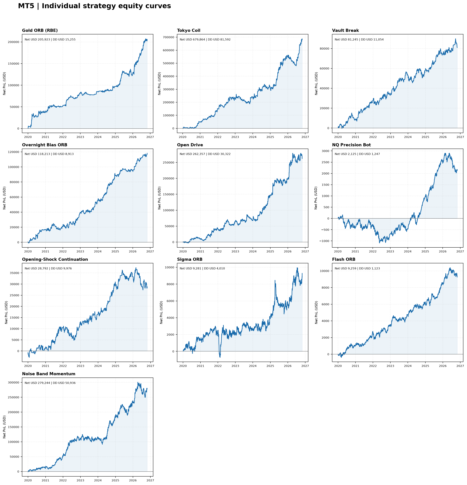
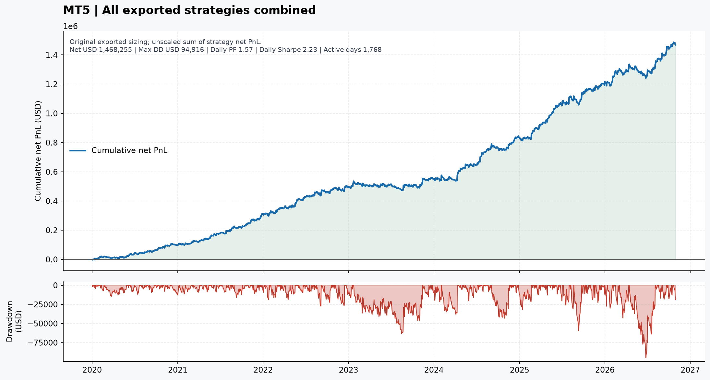
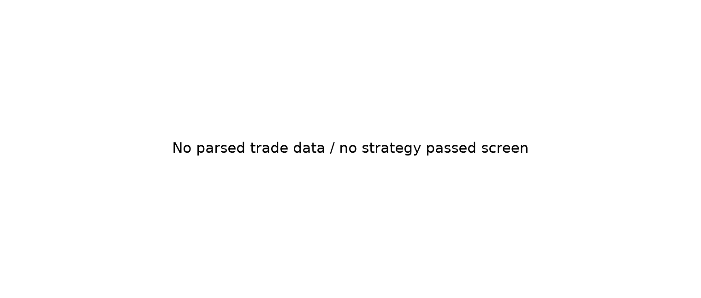

# MT5 research pack

**9 of 9 available exports parsed**

Gold X9 and Gold ORB (RBE) remain pending exports. VWAP Pullback is NT8-specific.

## Equity curve dashboard

## Portfolio curves

**All 9 available MT5 exports combined**

**Recommended shortlist**

## Individual strategy curves

- [Tokyo Coil](charts/individual/tokyo-coil.png)
- [Vault Break](charts/individual/vault-break.png)
- [Overnight Bias ORB](charts/individual/overnight-bias-orb.png)
- [Open Drive](charts/individual/open-drive.png)
- [NQ Precision Bot](charts/individual/nq-precision-bot.png)
- [Opening-Shock Continuation](charts/individual/opening-shock-continuation.png)
- [Sigma ORB](charts/individual/sigma-orb.png)
- [Flash ORB](charts/individual/flash-orb.png)
- [Noise Band Momentum](charts/individual/noise-band-momentum.png)

## Reports

- [Strategy metrics](reports/strategy_metrics.csv)
- [Portfolio metrics](reports/portfolio_metrics.csv)
- [Daily PnL](reports/daily_pnl.csv)
- [Daily PnL correlation matrix](reports/correlation_matrix.csv)
- [Annual PnL](reports/annual_pnl.csv)
- [Normalized event ledger](reports/normalized_event_ledger.csv)
- [Strategy manifest](reports/strategy_manifest.csv)
- [Data-quality checks](reports/data_quality.json)
- [Selection rationale](reports/recommendations.md)
- [Build summary](reports/summary.json)

Standard MT5 Strategy Tester reports use deal Profit + Commission + Swap; each reconciles to final balance less initial deposit. NQ Precision Bot uses the custom completed-trade ledger and Adj. Net P&L, which reconciles to the report summary. Timestamps are retained as exported broker/server time.
