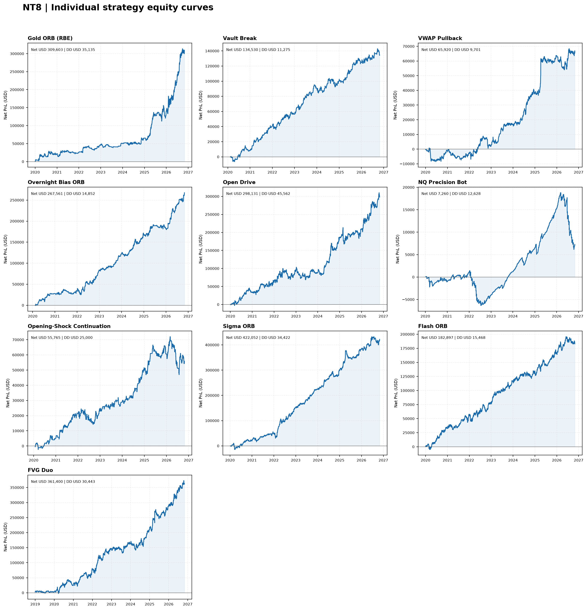
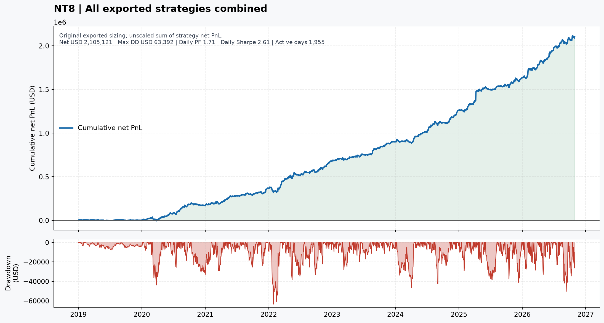
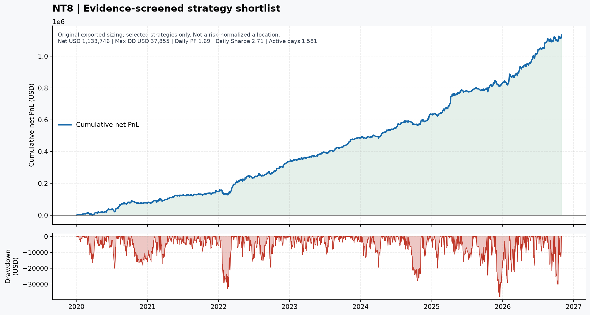

# NT8 research pack

**10 of 10 registered exports parsed.**

## Snapshot

| Portfolio | Net PnL | Max drawdown | Daily PF | Daily Sharpe |
|---|---:|---:|---:|---:|
| All 10 exports | $2,105,121.32 | $63,391.92 | 1.71 | 2.61 |
| Core 4 shortlist | $1,133,746.16 | $37,855.28 | 1.69 | 2.71 |

## Core shortlist

- Overnight Bias ORB
- Sigma ORB
- Vault Break
- Gold ORB (RBE)

## Reports

- [Strategy metrics](reports/strategy_metrics.csv)
- [Portfolio metrics](reports/portfolio_metrics.csv)
- [Daily PnL](reports/daily_pnl.csv)
- [Daily PnL correlation matrix](reports/correlation_matrix.csv)
- [Annual PnL](reports/annual_pnl.csv)
- [Normalized event ledger](reports/normalized_event_ledger.csv)
- [Strategy manifest](reports/strategy_manifest.csv)
- [Data-quality checks](reports/data_quality.json)
- [Selection rationale](reports/recommendations.md)
- [Build summary](reports/summary.json)

NT8 source is the NinjaTrader Strategy Analyzer CSV export. `Profit` is already net of `Commission`; commission is not subtracted twice. Curves use exported contract quantities and USD PnL. Timestamps are retained as exported.

Instrument coverage: GC DEC26; NQ DEC26.

## Equity curves

### Individual-strategy dashboard

### All strategies combined

### Core shortlist

### Individual curves

- [Gold ORB (RBE)](charts/individual/gold-orb-rbe.png)
- [Vault Break](charts/individual/vault-break.png)
- [VWAP Pullback](charts/individual/vwap-pullback.png)
- [Overnight Bias ORB](charts/individual/overnight-bias-orb.png)
- [Open Drive](charts/individual/open-drive.png)
- [NQ Precision Bot](charts/individual/nq-precision-bot.png)
- [Opening-Shock Continuation](charts/individual/opening-shock-continuation.png)
- [Sigma ORB](charts/individual/sigma-orb.png)
- [Flash ORB](charts/individual/flash-orb.png)
- [FVG Duo](charts/individual/fvg-duo.png)
