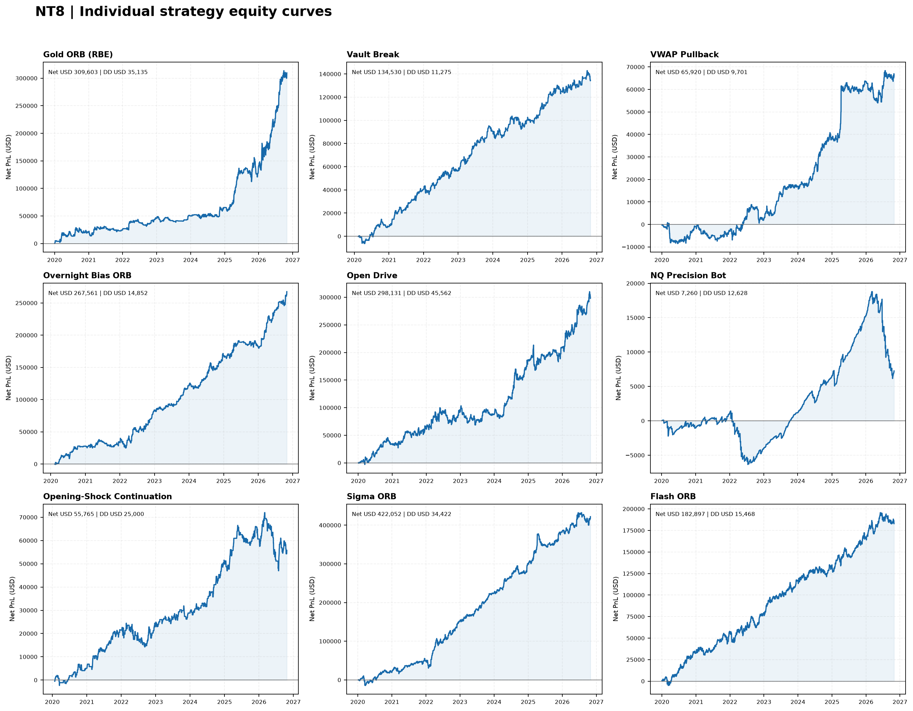
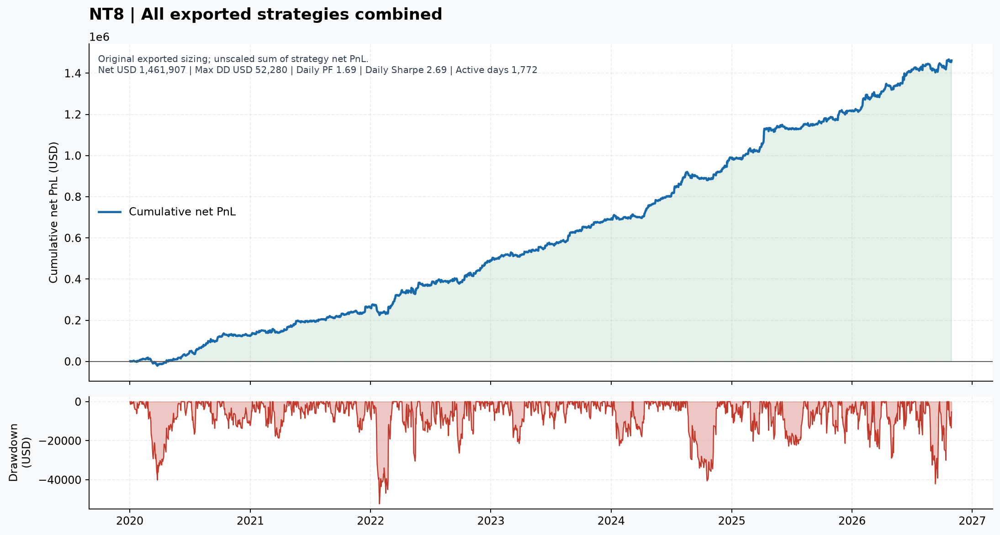
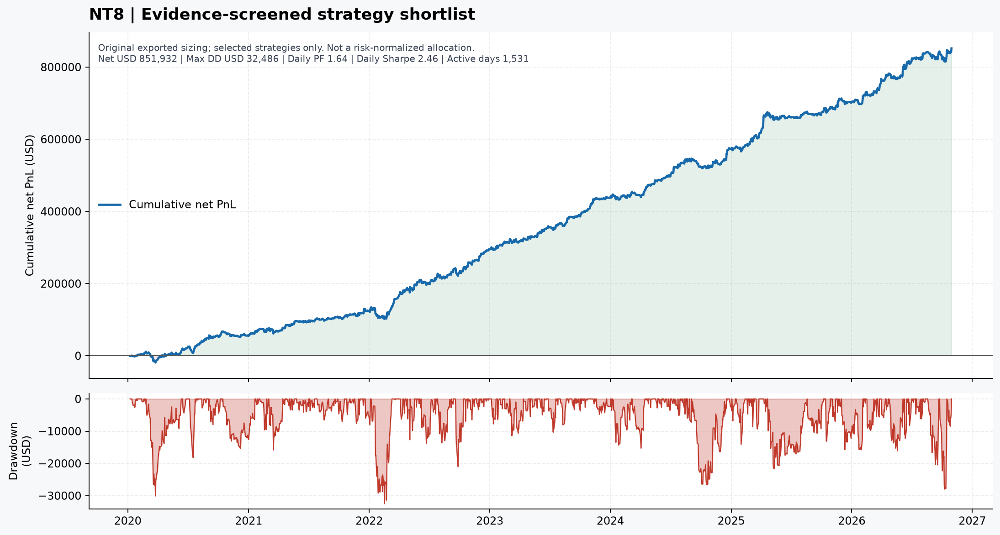

# NT8 research pack

**9 of 9 exports parsed**

## Equity curve dashboard

## Portfolio curves

**All NT8 exports combined**

**Recommended shortlist**

## Individual strategy curves

- [Gold ORB (RBE)](charts/individual/gold-orb-rbe.png)
- [Vault Break](charts/individual/vault-break.png)
- [VWAP Pullback](charts/individual/vwap-pullback.png)
- [Overnight Bias ORB](charts/individual/overnight-bias-orb.png)
- [Open Drive](charts/individual/open-drive.png)
- [NQ Precision Bot](charts/individual/nq-precision-bot.png)
- [Opening-Shock Continuation](charts/individual/opening-shock-continuation.png)
- [Sigma ORB](charts/individual/sigma-orb.png)
- [Flash ORB](charts/individual/flash-orb.png)

## Reports

- [Strategy metrics](reports/strategy_metrics.csv)
- [Portfolio metrics](reports/portfolio_metrics.csv)
- [Daily PnL](reports/daily_pnl.csv)
- [Daily PnL correlation matrix](reports/correlation_matrix.csv)
- [Annual PnL](reports/annual_pnl.csv)
- [Normalized event ledger](reports/normalized_event_ledger.csv)
- [Strategy manifest](reports/strategy_manifest.csv)
- [Data-quality checks](reports/data_quality.json)
- [Selection rationale](reports/recommendations.md)
- [Build summary](reports/summary.json)

NT8 source is NinjaTrader Strategy Analyzer CSV. The Profit field is net of exported Commission; do not subtract commission again. All 9 exports' summed Profit values match their final Cum. net profit. Curves use exported contract quantities and USD PnL. Timestamps are retained as exported.
