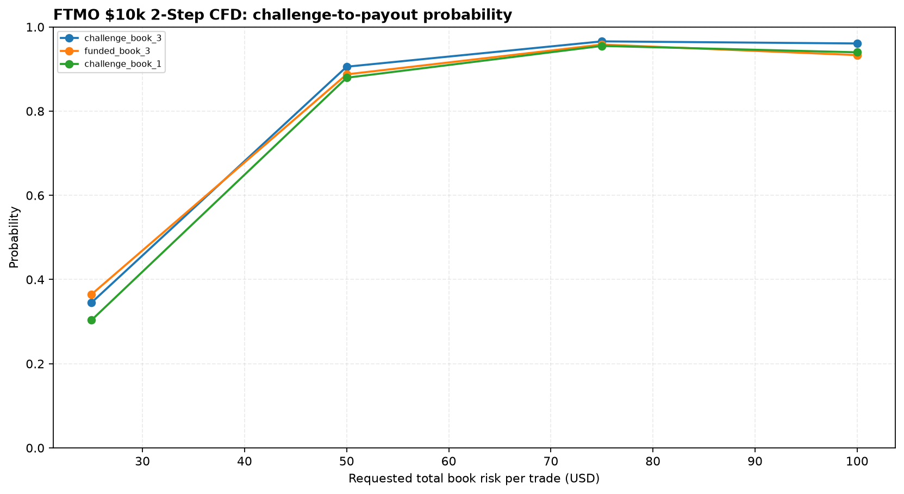
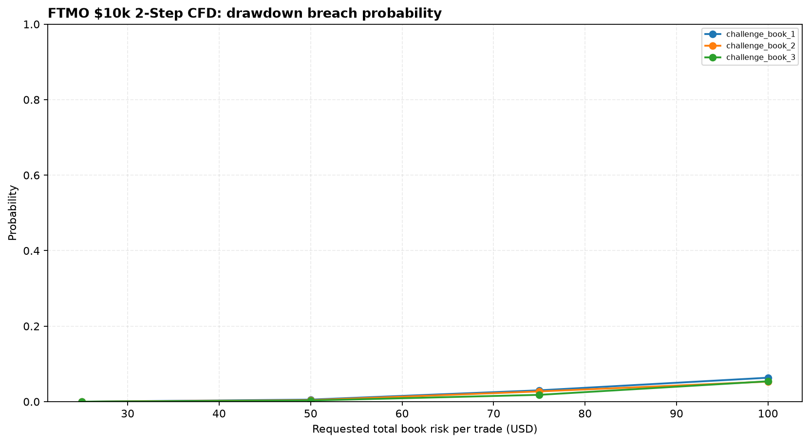
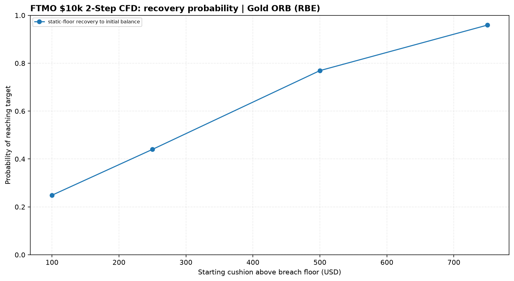

# FTMO $10,000 2-Step CFD

- [Account rules and assumptions](reports/account_rules.json)
- [Monte Carlo results](reports/monte_carlo_challenge_payout.csv)
- [Book rankings](reports/book_rankings.csv)
- [Book recommendations](reports/book_recommendations.md)
- [Recovery-mode scenarios](reports/recovery_mode.csv)

The model uses normalized daily R-multiples and a 5-trading-day circular block bootstrap. Each simulation uses 5,000 paths over 252 trading days. Tradeify uses at least one micro per sleeve and applies the four-mini cap.

## Important limits

- The source exports are closed-trade records, not a complete tick-by-tick account equity path.
- Daily rules are approximated from closed PnL. Tradeify MAE stress is a separate diagnostic; it is not an intraday replay.
- MT5 standard Deals exports lack position IDs; entry/exit legs use exact-volume matching where possible, with FIFO fallback.
- Timestamps remain as exported. The firm's timezone/session boundaries are not reconstructed.
- Strategy execution, native exits and stop behavior are not changed.
- Treat results as historical scenario estimates, not promises.

## Charts

