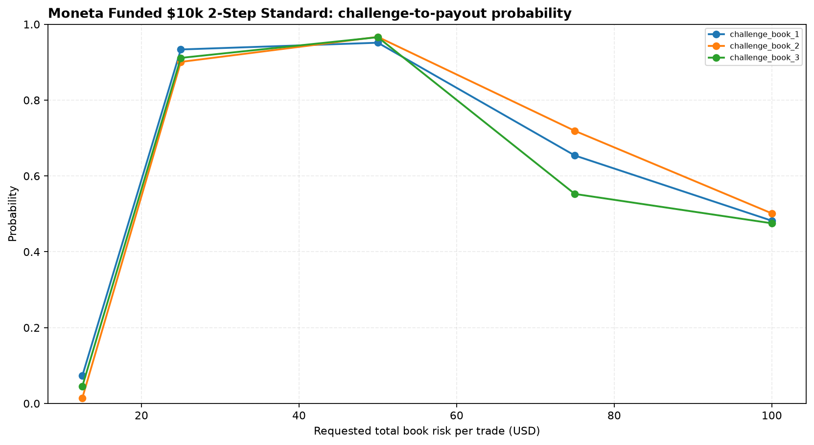
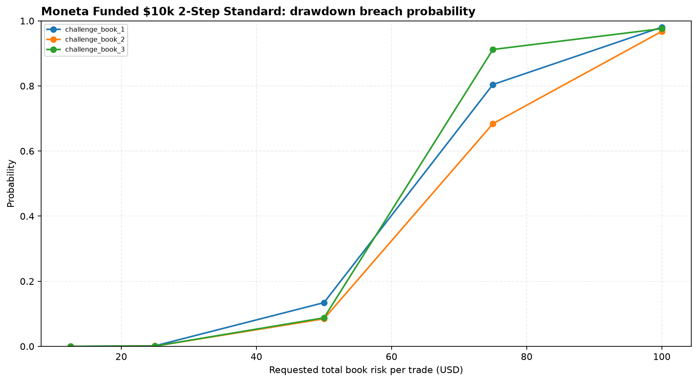

# Moneta Funded $25,000 2-Step Standard

- [Account rules and assumptions](reports/account_rules.json)
- [Monte Carlo results](reports/monte_carlo_challenge_payout.csv)
- [Methodology](../methodology.md)
- [Book rankings](reports/book_rankings.csv)
- [Book recommendations](reports/book_recommendations.md)
- [Recovery-mode scenarios](reports/recovery_mode.csv)
- [Stage sizing with real lot floors](reports/stage_sizing.md)
- [Stage sizing data](reports/stage_sizing.csv)
- [Pre-configured EA set files](../../Set-Files/Moneta-2Step-10K/README.md)

The model uses normalized daily R-multiples and a 5-trading-day block bootstrap aligned to complete Monday-Friday weeks. Each simulation uses 5,000 paths over 252 trading days. Risk ladder is USD 12.50–100 total book risk per trade, allocated equally across sleeves. Phase 1 needs +5% and Phase 2 needs +10%, so the ladder is a continuous-sizing idealization; [stage sizing with real lot floors](reports/stage_sizing.md) resizes every sleeve to a dollar target in whole 0.01 lots and models the funded switch. Phase 2 is the binding constraint: the 10% target at 4% daily and 8% static maximum loss is a much shorter fuse than a 5% one-step evaluation.

## Important limits

- The source exports are closed-trade records, not a complete tick-by-tick account equity path.
- The 4% daily limit is modeled as a hard breach (Moneta fails the account rather than pausing), with an 8% static maximum loss measured from the starting balance. The wider 5%/10% drawdown option is strictly larger, so these results are the conservative case. Intraday trigger timing, floating-loss breaches and the 5-minute news window around high-impact releases are not visible in the exports.
- MT5 RBE entry/exit legs use exact-volume matching where possible and FIFO fallback because the Deals export has no position IDs.
- Timestamps remain as exported. The firm's timezone/session boundaries are not reconstructed.
- Strategy execution, native exits and stop behavior are not changed.
- Recovery curves are balance-only; Moneta recovery measures return to the $10,000 funded initial balance above the static 8% floor (USD 800), not payout eligibility.
- Treat results as historical scenario estimates, not promises.

## Charts

