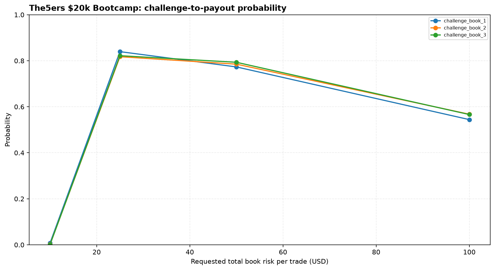
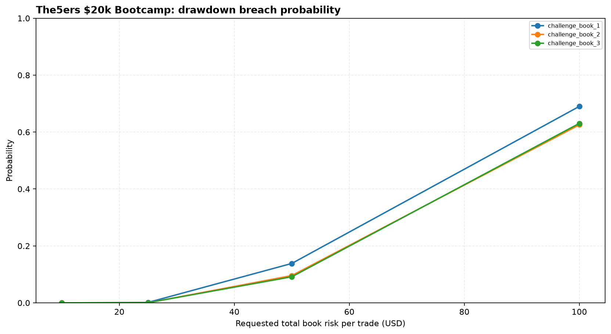
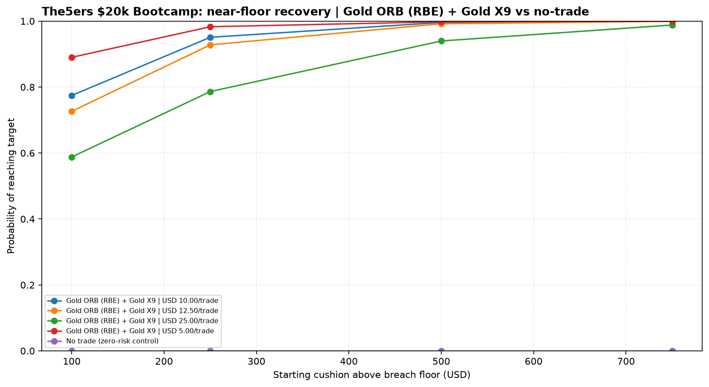

# The5ers $20,000 Bootcamp

- [Account rules and assumptions](reports/account_rules.json)
- [Monte Carlo results](reports/monte_carlo_challenge_payout.csv)
- [Methodology](../methodology.md)
- [Book rankings](reports/book_rankings.csv)
- [Book recommendations](reports/book_recommendations.md)
- [Recovery-mode scenarios](reports/recovery_mode.csv)
- [Stage sizing with real lot floors](reports/stage_sizing.md)
- [Stage sizing data](reports/stage_sizing.csv)

The model uses normalized daily R-multiples and a 5-trading-day block bootstrap aligned to complete Monday-Friday weeks. Each simulation uses 5,000 paths over 252 trading days. Risk ladder is USD 10–100 total book risk per trade, allocated equally across sleeves. That ladder is a continuous-sizing idealization: it does not enforce broker minimum lots. At 0.01 lot Gold X9 already risks about USD 20 per trade (0.4% of the $5k Step 1), so the real stage risk is set by that floor, not by the ladder. [Stage sizing with real lot floors](reports/stage_sizing.md) models the book with minimum-lot floors, the mid-account switch to the funded book, and per-sleeve percent sizing; [underlying CSV](reports/stage_sizing.csv). MT5 cash flows are divided by traded volume before the R unit is calibrated, so balance-compounding exports (Gold X9, Tokyo Coil) enter at per-lot risk.

## Important limits

- The source exports are closed-trade records, not a complete tick-by-tick account equity path.
- Evaluation has no daily loss limit, so only the 5% static per-step maximum loss can fail a step. The funded account adds a 3% daily pause, modeled as a closed-PnL clip: intraday trigger timing and overshoot are not visible in the exports, and the 5% funded scale-up ladder is not modeled.
- MT5 RBE entry/exit legs use exact-volume matching where possible and FIFO fallback because the Deals export has no position IDs.
- Timestamps remain as exported. The firm's timezone/session boundaries are not reconstructed.
- Strategy execution, native exits and stop behavior are not changed.
- Recovery curves are balance-only; The5ers recovery measures return to the funded $20,000 initial balance above the static 4% floor, not payout eligibility.
- Treat results as historical scenario estimates, not promises.

## Charts

