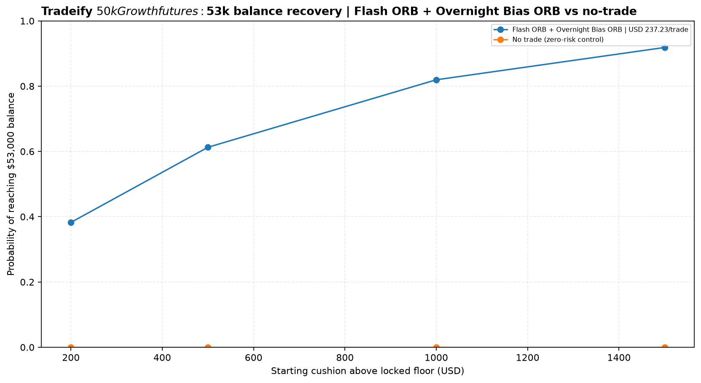

# Tradeify $50,000 Growth futures

- [Account rules and assumptions](reports/account_rules.json)
- [Monte Carlo results](reports/monte_carlo_evaluation_funded_payout.csv)
- [Methodology](../methodology.md)
- [Book rankings](reports/book_rankings.csv)
- [Book recommendations](reports/book_recommendations.md)
- [Recovery-mode scenarios](reports/recovery_mode.csv)
- [Intraday MAE / soft-DLL stress](reports/mae_soft_dll_stress.csv)

The model uses normalized daily R-multiples and a 5-trading-day block bootstrap aligned to complete Monday-Friday weeks. Each simulation uses 5,000 paths over 252 trading days. Growth evaluation has no consistency rule. At least one trade per complete Monday-Friday week is required during evaluation and funded trading. Funded payouts require 35% consistency, five winning days above $150, a $53,000 balance and the microscalping test. Whole-micro sizing uses at least one micro per active sleeve and a four-mini concurrent cap; effective risk after minimum sizing is shown.

## Important limits

- The source exports are closed-trade records, not a complete tick-by-tick account equity path.
- The initial $1,250 soft daily-loss limit is modeled as a closed-PnL clip; after the funded balance reaches $53,000, the model applies the official $2,000 DLL from the next session. Intraday trigger timing, overshoot and trade sequence remain unknown. The EOD trailing drawdown is modeled from daily closes; NT8 MAE is a separate diagnostic.
- NT8 MAE stacks same-entry-day adverse excursions across active sleeves; it is not a synchronized intraday equity replay.
- Timestamps remain as exported. The firm's timezone/session boundaries are not reconstructed.
- Strategy execution, native exits and stop behavior are not changed.
- Recovery curves are balance-only. The $53,000 target does not enforce payout consistency, five $150 winning days or payout processing.
- Treat results as historical scenario estimates, not promises.

## Charts

