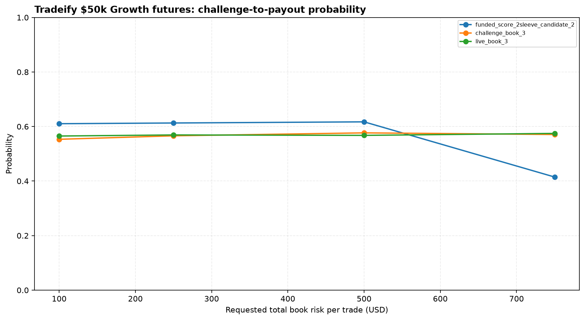
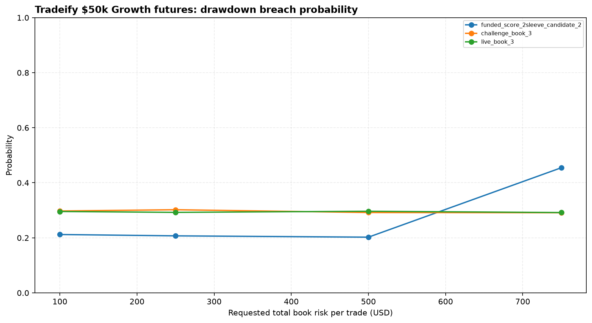
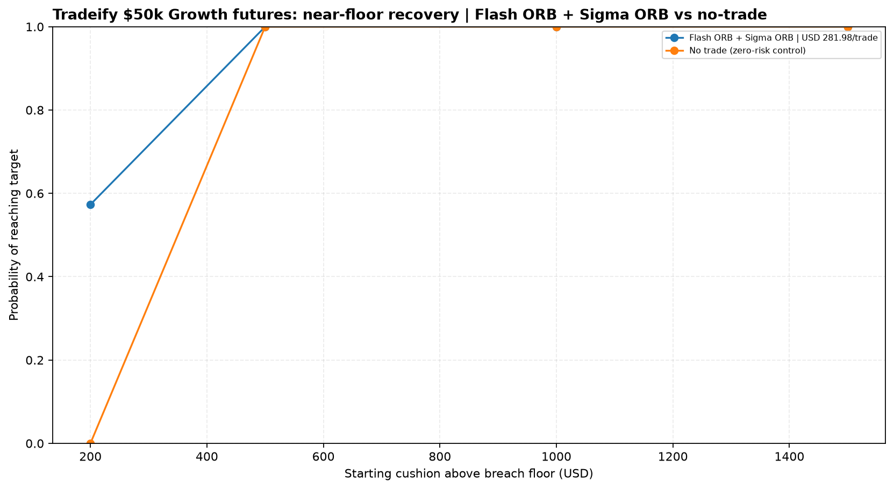
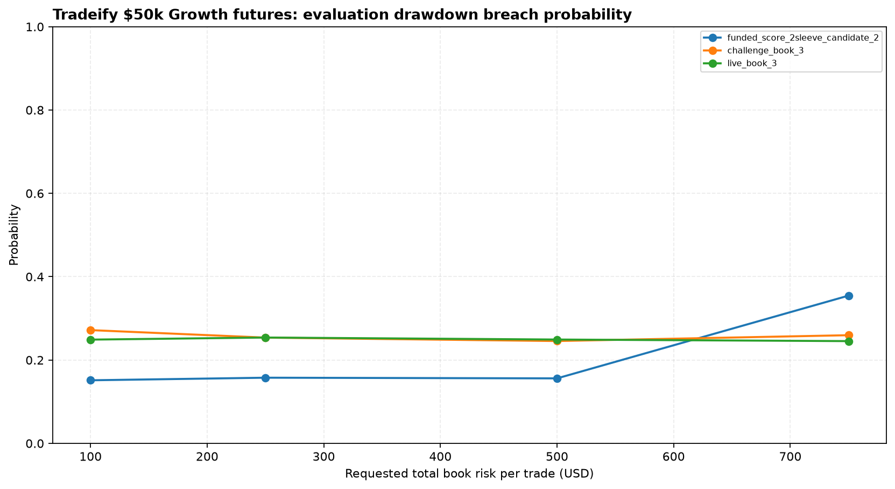
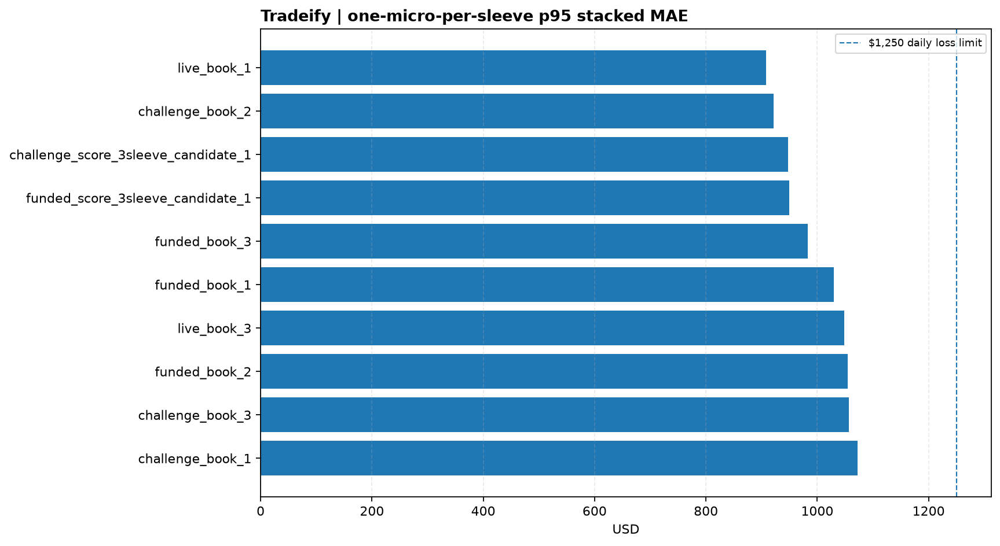

# Tradeify $50,000 Growth futures

- [Account rules and assumptions](reports/account_rules.json)
- [Monte Carlo results](reports/monte_carlo_evaluation_funded_payout.csv)
- [Methodology](../methodology.md)
- [Book rankings](reports/book_rankings.csv)
- [Book recommendations](reports/book_recommendations.md)
- [Recovery-mode scenarios](reports/recovery_mode.csv)
- [Intraday MAE / soft-DLL stress](reports/mae_soft_dll_stress.csv)

The model uses normalized daily R-multiples and a 5-trading-day circular block bootstrap. Each simulation uses 5,000 paths over 252 trading days. Growth evaluation has no consistency rule; funded payouts require 35% consistency and five winning days above $150. Whole-micro sizing uses at least one micro per active sleeve and a four-mini concurrent cap; full size is available from day one. Effective risk after minimum sizing is shown in the results.

## Important limits

- The source exports are closed-trade records, not a complete tick-by-tick account equity path.
- Tradeify EOD trailing drawdown is modeled from daily closes. The $1,250 soft daily-loss limit is approximated by clipping closed daily losses at -$1,250; intraday trigger timing and overshoot remain unknown. NT8 MAE is a separate diagnostic.
- NT8 MAE is available for the separate soft-DLL stress diagnostic.
- Timestamps remain as exported. The firm's timezone/session boundaries are not reconstructed.
- Strategy execution, native exits and stop behavior are not changed.
- Treat results as historical scenario estimates, not promises.

## Charts

