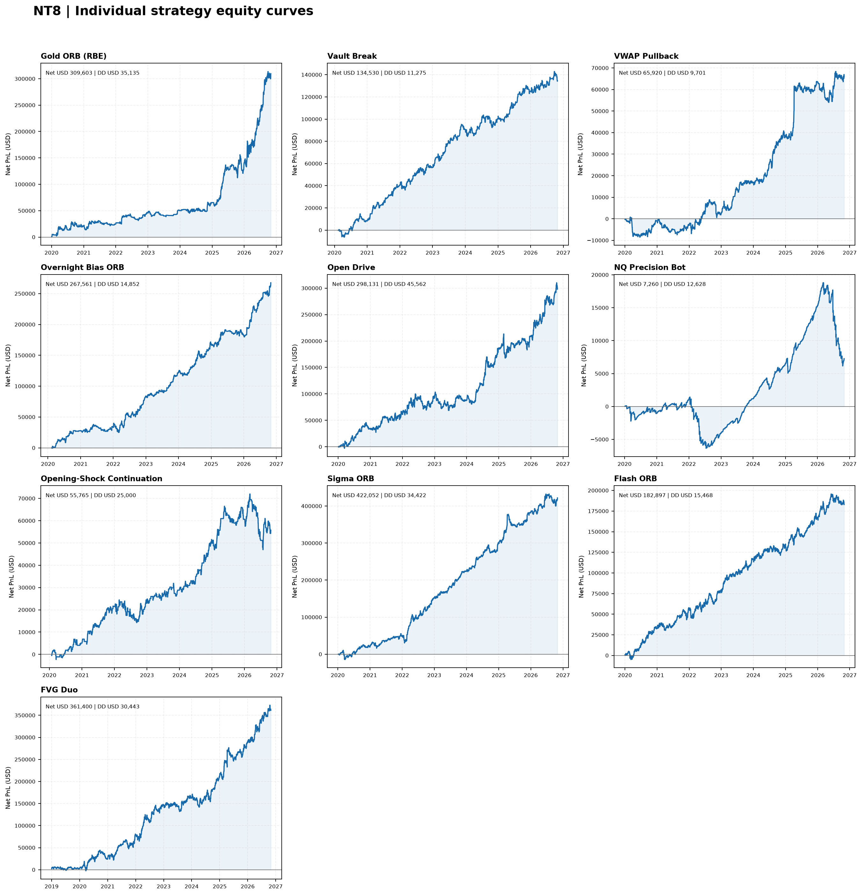
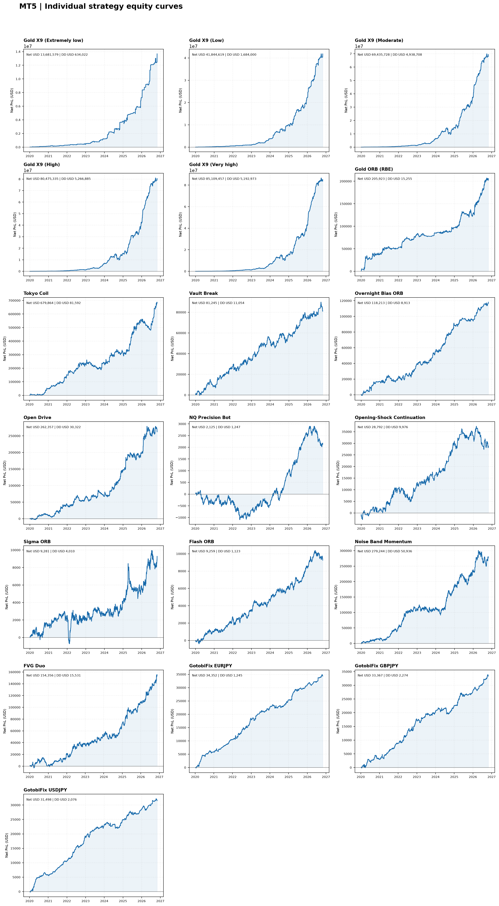

# Portfolio Research

Research workspace for the NT8 futures and MT5 CFD strategy exports. Raw export analysis, normalized live-account curves, and prop-firm simulations are kept separate.

## Source export layout

- NT8 source exports: `Trades/NT8 Trades/` (10 CSV files).
- MT5 source exports: `Trades/MT5 Trades/` (15 XLSX files).
- `analysis/strategies.json` is the single registry both engines read. The build fails before publishing if a registered export is missing, fails parsing, or if an export sits in `Trades/` without a registry entry.
- To add a system, follow [Adding a new strategy](analysis/ADDING-A-STRATEGY.md).

## Deliverables

- [Raw NT8 research pack](NT8/README.md)
- [Raw MT5 research pack](MT5/README.md)
- [Normalized live-account research](Normalized-Live/README.md) ([methodology](Normalized-Live/methodology.md))
- [Prop-firm research](Prop-Firms/README.md) ([methodology](Prop-Firms/methodology.md))
- [Strategy, per-sleeve roles and book suitability](reports/strategy_suitability.md)
- [Adding a new strategy to the repository](analysis/ADDING-A-STRATEGY.md)
- [NQ minute archive data audit](reports/nq_minute_data_audit.md)
- [NQ data handoff for the website strategy builder](reports/nq_strategy_builder_handoff.md)
- [NQ M1 audit artifacts and rebuild scripts](data/NQ-M1/README.md)
- [Latest raw build summary](reports/run_summary.json)
- [Raw export analysis engine](analysis/build_equity_reports.py)
- [Normalized and prop-firm engine](analysis/build_live_and_prop_reports.py)

## Export inventory

- **NT8: 10/10 registered exports parsed.** Gold ORB (RBE), Vault Break, VWAP Pullback, Overnight Bias ORB, Open Drive, NQ Precision Bot, Opening-Shock Continuation, Sigma ORB, Flash ORB and FVG Duo.
- **MT5: 19/19 registered exports parsed.** Gold X9 at five `TradeFrequency` presets (Extremely low / Low / Moderate / High / Very high, mutually exclusive), Gold ORB (RBE), Tokyo Coil, Vault Break, Overnight Bias ORB, Open Drive, NQ Precision Bot, Opening-Shock Continuation, Sigma ORB, Flash ORB, Noise Band Momentum, FVG Duo and GotobiFix EURJPY / GBPJPY / USDJPY.
- VWAP Pullback is NT8-specific. Tokyo Coil, Noise Band Momentum, FVG Duo and the GotobiFix pairs are MT5-specific; FVG Duo also exists on NT8.

Instruments: NT8 Gold ORB (RBE) runs on **GC DEC26**; every other NT8 export, including FVG Duo, runs on **NQ DEC26**. MT5 Gold X9 and RBE use **XAUUSD**, Tokyo Coil and the GotobiFix pairs use JPY crosses (USDJPY, EURJPY, GBPJPY), and the remaining MT5 exports use USTEC.

**Position sizing varies in the MT5 exports.** Gold X9 (≈0.46 → 51.47 lots) and Tokyo Coil (≈9.4 → 38.4 lots) size from account balance, so their exported dollar curves are compounding tester runs, not fixed-size comparisons. The normalized and prop-firm layers divide each trade's cash flow by traded volume first, so those layers are comparable across systems; the raw MT5 total below is not.

## Raw-export core shortlist

- **NT8:** Overnight Bias ORB, Sigma ORB, Vault Break, Gold ORB (RBE).
- **MT5:** Gold X9, GotobiFix EURJPY, GotobiFix USDJPY, Gold ORB (RBE).

These are first-pass export-screening candidates, not live-deployment approval. Normalized and prop-firm selection is performed separately. Gold X9 leads the raw MT5 screen on a compounded curve; confirm its edge survives the per-lot normalization in the normalized-live reports before acting on it.

## Raw portfolio summary

| Platform | Portfolio | Net PnL | Max drawdown | Daily PF | Daily Sharpe |
|---|---|---:|---:|---:|---:|
| NT8 | All 10 exports | $2,105,121.32 | $63,391.92 | 1.71 | 2.61 |
| NT8 | Core 4 shortlist | $1,133,746.16 | $37,855.28 | 1.69 | 2.71 |
| MT5 | All 15 exports | $81,944,165.86 | $4,653,710.89 | 2.63 | 2.50 |
| MT5 | Core 4 shortlist | $80,286,062.82 | $4,678,072.04 | 2.61 | 2.45 |

Daily PF and daily Sharpe use daily aggregated net PnL, not individual-trade PF/Sharpe. Max drawdown is measured from the cumulative exported PnL curve. The MT5 totals are dominated by Gold X9's balance-compounding run; read [MT5/README.md](MT5/README.md) and the normalized-live reports before comparing platforms.

## Normalized live-account research

[Open Normalized-Live](Normalized-Live/README.md)

- NT8: one exported contract equivalent per strategy, equity starts at USD 0.
- MT5: fixed USD 100 risk proxy per completed trade, computed on **per-lot** PnL so balance-compounding exports are comparable, equity starts at USD 0.
- All one-to-four-sleeve combinations are screened. Individual sleeves and selected books receive block-bootstrap drawdown analysis.
- Live risk-of-ruin figures are R-multiple drawdown barriers, not literal account ruin probabilities because no account balance was specified.

One GC contract and one NQ contract are not equal-risk exposures. MT5's USD 100 sizing uses each sleeve's training-period per-lot mean realized loss as its R proxy, not the strategy's initial stop risk. That calibration is held fixed in validation.

## Prop-firm research

[Open Prop-Firms](Prop-Firms/README.md)

- [The5ers $20,000 Bootcamp](Prop-Firms/The5ers-20K-Bootcamp/README.md)
- [Moneta Funded $10,000 2-Step Standard](Prop-Firms/Moneta-2Step-10K/README.md)
- [Tradeify $50,000 Growth futures](Prop-Firms/Tradeify-50K-Growth-Futures/README.md)

Pre-configured EA presets for each firm and stage, ready to load:
[Set-Files](Set-Files/README.md) (the working copy for the trading machine lives in
`Documents/Portfolio/Set-Files`).

The prop simulations use 5,000 Monte Carlo paths for every one-to-four-sleeve combination across the full firm-specific risk ladders, with five-day blocks aligned to complete Monday-Friday weeks and a 252-trading-day horizon. Primary books are selected on training-only scores; validation-best rows are diagnostic only. Near-floor recovery separately screens positive-training single sleeves and pairs. Tradeify evaluation pass rates require weekly activity and position-limit compliance. Microscalping is an additional funded payout-eligibility check. The5ers Bootcamp uses a USD 10–$100 total book-risk ladder across a 3-step evaluation ($5k/$10k/$15k, 6% target and 5% static max loss per step) and a $20k funded account (4% static max loss, 3% daily pause, 50% split, 14-day payout cycle). Moneta uses a USD 12.50–100 ladder across a $10k 2-Step Standard (Phase 1 +5%, Phase 2 +10%, 4% daily and 8% static max loss, three profitable 0.5% days per phase and payout cycle, 88% split, 14-day cycle) and is also re-sized in whole 0.01 lots. Tradeify uses $100–$750 requested total book risk, whole-micro sizing, at least one micro per active sleeve, and a four-mini concurrent exposure cap. Actual risk can exceed the requested amount because of the minimum micro size.

The prop Monte Carlo reports now include mean, median and 10th-percentile monthly strategy PnL, monthly peak-to-trough drawdown percentiles, and 252-day max-drawdown stress. These monthly figures are strategy-stream estimates before account failures, DLL clipping, payout rules or withdrawal resets; payout probability and cash payout are modeled separately.

Tradeify Growth evaluation has no consistency rule. The funded model applies the official 35% payout consistency rule, five profitable days above $150, the $53,000 minimum payout balance and current payout caps. The initial $1,250 soft daily-loss limit is approximated with closed-PnL clipping; after funded balance reaches $53,000, the model applies the $2,000 limit from the next session and assumes it remains unlocked after payouts. Intraday trigger timing and overshoot remain unknown.

## Validation and data quality

- All 10 NT8 exports parsed. Each file's Profit sum reconciles to its final exported cumulative net profit.
- All 15 MT5 exports parsed. Standard Strategy Tester reports reconcile deal Profit + Commission + Swap to final balance minus initial deposit; the custom ledgers (NQ Precision Bot, GotobiFix) reconcile adjusted net PnL to their reported totals.
- MT5 NQ Precision Bot uses its custom completed-trade ledger; Adj. Net P&L reconciles to the report's Total Net Profit.
- The MT5 RBE Deals table has no position ID and contains overlapping positions. Entry/exit legs are paired by symbol/side and exact volume where possible, with FIFO fallback. Cashflows reconcile, but RBE duration and trade-level risk estimates retain pairing uncertainty.
- Export history spans 2020 through 30 October 2026 on NT8 and 19 November 2026 on MT5. The separate NQ M1 archive has now been decoded and audited, but the normalized/prop reports remain export-based; no independent strategy replay from M1 bars has yet been run. Raw market data and converted bars are not committed to this public repository.

## Methodology and limits

- NT8 Profit is used as exported; it is already net of Commission, so commission is not subtracted again.
- MT5 standard reports use deal Profit + Commission + Swap. The NQ Precision Bot custom ledger uses Adj. Net P&L.
- Raw curves use original exported quantities/lots. They do not model margin, simultaneous exposure, execution conflicts, prop-firm rules or capital allocation.
- Normalized MT5 risk units use per-lot mean absolute realized losing-trade PnL from the first 60% training period, held fixed in validation. This removes balance-based compounding (Gold X9, Tokyo Coil) and is a sizing proxy, not verified initial stop risk.
- Strategy PnL is timestamped at exit for completed-trade curves. Activity is timestamped by entry date. Timestamps remain as exported; no timezone conversion is assumed.
- Prop simulations use a chronological 60/40 train/validation split. Book selection is performed on the first 60%; Monte Carlo evaluation uses the later validation sample.
- Tradeify's $2,000 EOD trailing drawdown and $50,100 locked floor are modeled. Its soft DLL is approximated by clipping daily closed-PnL losses at $1,250 initially and $2,000 from the next session after the funded balance reaches $53,000; the model assumes the higher DLL remains after payouts. Intraday pause timing and overshoot are unknown. NT8 MAE is a separate stress diagnostic.
- The5ers evaluation has no daily loss limit; each step fails only on the 5% static max loss. The funded 3% daily pause is approximated by clipping closed daily PnL at -3% of the start-of-day balance. MT5 exports contain no intratrade MAE, so floating-loss breaches and intraday pause timing are not reconstructed. The 14-calendar-day payout cycle is approximated as 10 trading days at a 50% split, balance resets to $20,000 after withdrawal, and the 5% funded scale-up ladder is not modeled.
- News restrictions, correlated-product hedging, broker margin, instrument-specific minimum lot sizes, slippage beyond exported costs, and exact timezone/session conversion are not fully modeled.
- No strategy logic, native exits, stops, or parameters were redesigned or optimized.

## Rebuild

```bash
python -m pip install -r analysis/requirements.txt
python analysis/build_equity_reports.py
python analysis/inspect_mt5_headers.py
python analysis/build_live_and_prop_reports.py
```

GitHub Actions rebuilds the reports when source exports or analysis code change.

## Equity curves

### NT8 raw exports



- [All 10 NT8 strategies combined](NT8/charts/portfolios/all_strategies.png)
- [NT8 core 4 shortlist](NT8/charts/portfolios/recommended_strategies.png)
- [All individual NT8 curves](NT8/charts/individual/)

### MT5 raw exports



- [All 15 MT5 strategies combined](MT5/charts/portfolios/all_strategies.png)
- [MT5 core 4 shortlist](MT5/charts/portfolios/recommended_strategies.png)
- [All individual MT5 curves](MT5/charts/individual/)
