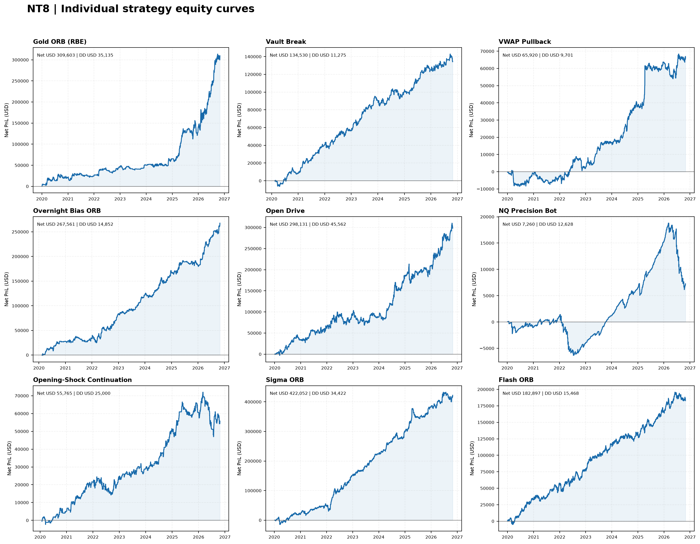
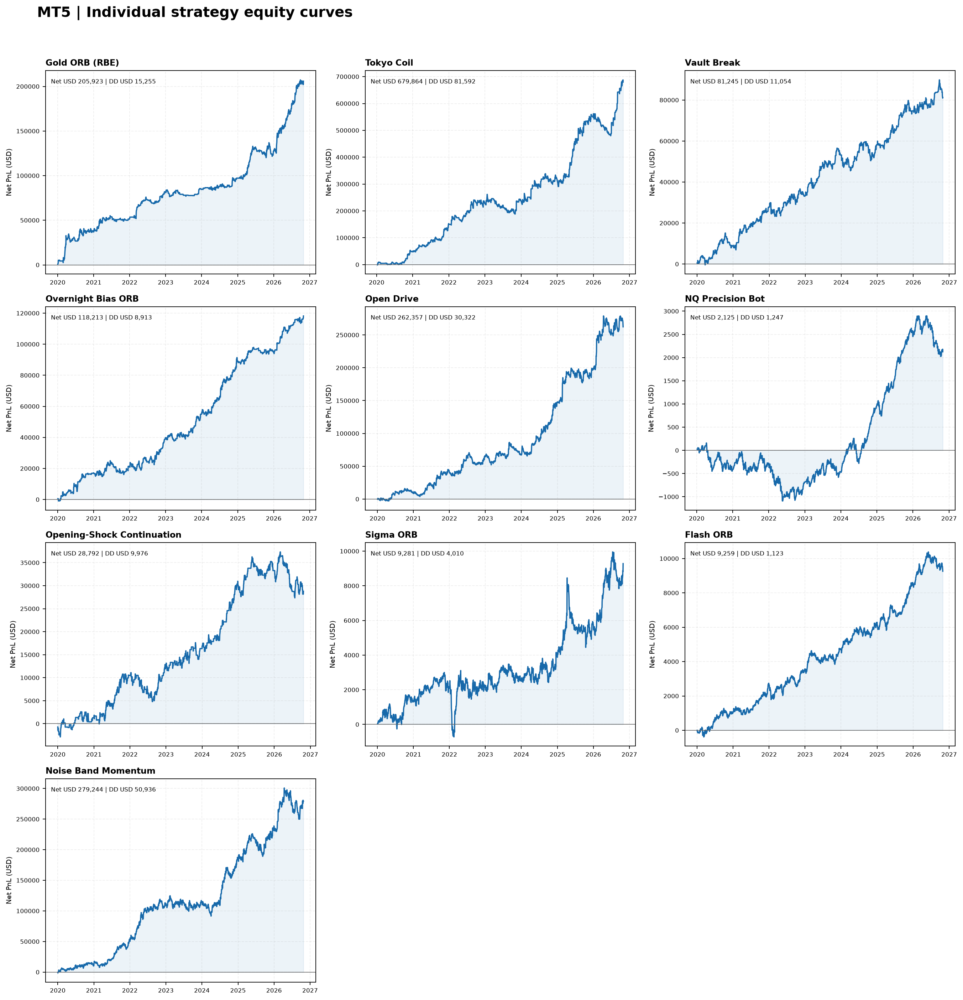

# Portfolio Research

Research workspace for the NT8 futures and MT5 CFD strategy exports. Raw export analysis, normalized live-account curves, and prop-firm simulations are kept separate.

## Deliverables

- [Raw NT8 research pack](NT8/README.md)
- [Raw MT5 research pack](MT5/README.md)
- [Normalized live-account research](Normalized-Live/README.md) ([methodology](Normalized-Live/methodology.md))
- [Prop-firm research](Prop-Firms/README.md) ([methodology](Prop-Firms/methodology.md))
- [Strategy, per-sleeve roles and book suitability](reports/strategy_suitability.md)
- [NQ minute archive data audit](reports/nq_minute_data_audit.md)
- [NQ data handoff for the website strategy builder](reports/nq_strategy_builder_handoff.md)
- [NQ M1 audit artifacts and rebuild scripts](data/NQ-M1/README.md)
- [Latest raw build summary](reports/run_summary.json)
- [Raw export analysis engine](analysis/build_equity_reports.py)
- [Normalized and prop-firm engine](analysis/build_live_and_prop_reports.py)

## Export inventory

- **NT8: 9/9 exports parsed.** Gold ORB (RBE), Vault Break, VWAP Pullback, Overnight Bias ORB, Open Drive, NQ Precision Bot, Opening-Shock Continuation, Sigma ORB and Flash ORB.
- **MT5: 10/11 exports parsed.** Gold ORB (RBE), Tokyo Coil, Vault Break, Overnight Bias ORB, Open Drive, NQ Precision Bot, Opening-Shock Continuation, Sigma ORB, Flash ORB and Noise Band Momentum. Gold X9 remains pending.
- VWAP Pullback is NT8-specific. Tokyo Coil and Noise Band Momentum are MT5-specific.

The refreshed NT8 RBE CSV reports **GC DEC26**. Other NT8 exports use NQ. The refreshed MT5 RBE XLSX reports XAUUSD; MT5 Tokyo Coil uses USDJPY; the other MT5 exports use USTEC.

## Raw-export core shortlist

- **NT8:** Overnight Bias ORB, Sigma ORB, Vault Break, Gold ORB (RBE).
- **MT5:** Gold ORB (RBE), Overnight Bias ORB, Tokyo Coil, Open Drive.

These are first-pass export-screening candidates, not live-deployment approval. Normalized and prop-firm selection is performed separately.

## Raw portfolio summary

| Platform | Portfolio | Net PnL | Max drawdown | Daily PF | Daily Sharpe |
|---|---|---:|---:|---:|---:|
| NT8 | All 9 exports | $1,743,720.84 | $52,302.04 | 1.76 | 2.94 |
| NT8 | Core 4 shortlist | $1,133,746.16 | $37,855.28 | 1.69 | 2.71 |
| MT5 | All 10 available exports | $1,676,302.62 | $76,232.35 | 1.64 | 2.49 |
| MT5 | Core 4 shortlist | $1,266,355.98 | $70,255.73 | 1.65 | 2.31 |

Daily PF and daily Sharpe use daily aggregated net PnL, not individual-trade PF/Sharpe. Max drawdown is measured from the cumulative exported PnL curve.

## Normalized live-account research

[Open Normalized-Live](Normalized-Live/README.md)

- NT8: one exported contract equivalent per strategy, equity starts at USD 0.
- MT5: fixed USD 100 risk proxy per completed trade, equity starts at USD 0.
- All one-to-four-sleeve combinations are screened. Individual sleeves and selected books receive block-bootstrap drawdown analysis.
- Live risk-of-ruin figures are R-multiple drawdown barriers, not literal account ruin probabilities because no account balance was specified.

One GC contract and one NQ contract are not equal-risk exposures. MT5's USD 100 sizing uses each sleeve's training-period mean realized loss as its R proxy, not the strategy's initial stop risk. That calibration is held fixed in validation.

## Prop-firm research

[Open Prop-Firms](Prop-Firms/README.md)

- [FTMO $10,000 2-Step CFD](Prop-Firms/FTMO-10K-2Step-CFD/README.md)
- [Tradeify $50,000 Growth futures](Prop-Firms/Tradeify-50K-Growth-Futures/README.md)

The prop simulations use 5,000 Monte Carlo paths for every one-to-four-sleeve combination across the full firm-specific risk ladders, with five-day blocks aligned to complete Monday-Friday weeks and a 252-trading-day horizon. Primary books are selected on training-only scores; validation-best rows are diagnostic only. Near-floor recovery separately screens positive-training single sleeves and pairs. Tradeify evaluation pass rates require weekly activity and position-limit compliance. Microscalping is an additional funded payout-eligibility check. FTMO uses a total book-risk ladder of $25–$100. Tradeify uses $100–$750 requested total book risk, whole-micro sizing, at least one micro per active sleeve, and a four-mini concurrent exposure cap. Actual risk can exceed the requested amount because of the minimum micro size.

Tradeify Growth evaluation has no consistency rule. The funded model applies the official 35% payout consistency rule, five profitable days above $150, the $53,000 minimum payout balance and current payout caps. The initial $1,250 soft daily-loss limit is approximated with closed-PnL clipping; after funded balance reaches $53,000, the model applies the $2,000 limit from the next session and assumes it remains unlocked after payouts. Intraday trigger timing and overshoot remain unknown.

## Validation and data quality

- All 9 NT8 exports parsed. Each file's Profit sum reconciles to its final exported cumulative net profit.
- All 9 standard MT5 Strategy Tester reports reconcile deal Profit + Commission + Swap to final balance minus initial deposit.
- MT5 NQ Precision Bot uses its custom completed-trade ledger; Adj. Net P&L reconciles to the report's Total Net Profit.
- The MT5 RBE Deals table has no position ID and contains overlapping positions. Entry/exit legs are paired by symbol/side and exact volume where possible, with FIFO fallback. Cashflows reconcile, but RBE duration and trade-level risk estimates retain pairing uncertainty.
- Export history spans 2020 through 30 October 2026. The separate NQ M1 archive has now been decoded and audited, but the normalized/prop reports remain export-based; no independent strategy replay from M1 bars has yet been run. Raw market data and converted bars are not committed to this public repository.

## Methodology and limits

- NT8 Profit is used as exported; it is already net of Commission, so commission is not subtracted again.
- MT5 standard reports use deal Profit + Commission + Swap. The NQ Precision Bot custom ledger uses Adj. Net P&L.
- Raw curves use original exported quantities/lots. They do not model margin, simultaneous exposure, execution conflicts, prop-firm rules or capital allocation.
- Normalized MT5 risk units use mean absolute realized losing-trade PnL from the first 60% training period, held fixed in validation. This is a sizing proxy, not verified initial stop risk.
- Strategy PnL is timestamped at exit for completed-trade curves. Activity is timestamped by entry date. Timestamps remain as exported; no timezone conversion is assumed.
- Prop simulations use a chronological 60/40 train/validation split. Book selection is performed on the first 60%; Monte Carlo evaluation uses the later validation sample.
- Tradeify's $2,000 EOD trailing drawdown and $50,100 locked floor are modeled. Its soft DLL is approximated by clipping daily closed-PnL losses at $1,250 initially and $2,000 from the next session after the funded balance reaches $53,000; the model assumes the higher DLL remains after payouts. Intraday pause timing and overshoot are unknown. NT8 MAE is a separate stress diagnostic.
- FTMO equity-based daily/max-loss breaches can occur from floating losses. MT5 exports do not contain intratrade MAE, so FTMO results use closed-PnL paths. Phase review and KYC/activation delays are not modeled. The first Reward Day is approximated as 10 elapsed trading days after the first funded trade; four business days are reserved for review/payment with trading frozen. Cash withdrawal pays 80% of reference-period profit and resets the next reference period to initial capital; rollover is not modeled.
- News restrictions, correlated-product hedging, broker margin, instrument-specific minimum lot sizes, slippage beyond exported costs, and exact timezone/session conversion are not fully modeled.
- No strategy logic, native exits, stops, or parameters were redesigned or optimized.

## Rebuild

```bash
python -m pip install -r analysis/requirements.txt
python analysis/build_equity_reports.py
python analysis/build_live_and_prop_reports.py
```

GitHub Actions rebuilds the reports when source exports or analysis code change.

## Equity curves

### NT8 raw exports



- [All 9 NT8 strategies combined](NT8/charts/portfolios/all_strategies.png)
- [NT8 core 4 shortlist](NT8/charts/portfolios/recommended_strategies.png)
- [All individual NT8 curves](NT8/charts/individual/)

### MT5 raw exports



- [All 10 available MT5 strategies combined](MT5/charts/portfolios/all_strategies.png)
- [MT5 core 4 shortlist](MT5/charts/portfolios/recommended_strategies.png)
- [All individual MT5 curves](MT5/charts/individual/)
